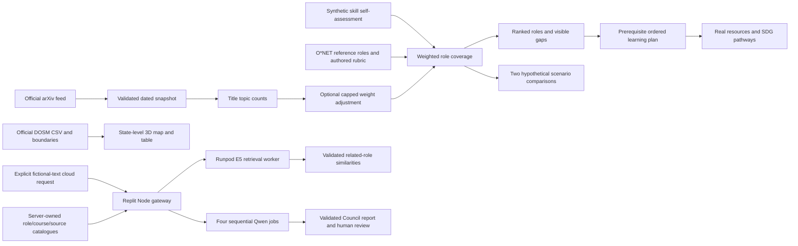

# Architecture and model card

Updated 25 October 2026, Asia/Kuala_Lumpur. Purpose: exploratory learning and career planning using synthetic profiles. Not suitable for hiring, screening, admission, credit, salary estimation or individual risk assessment.

## Data flow

## Components and separation

`src/components/Atlas.tsx` owns shared profile, role, evidence and navigation state. `World.tsx` renders client-only R3F worlds with demand-driven rendering and a device-pixel-ratio cap. All numerical results and selections are also in HTML panels. `EvidenceControls.tsx` exposes research adjustments and individual skill-to-SDG pathways.

`src/lib/catalogue.ts` contains authored skills, six referenced occupations, course/resource links, sample people, curated trend summaries and SDG mappings. `engine.ts` contains pure matching, pathway, scenario and export functions. `signals.ts` contains keyword topic classification and classical TF-IDF text retrieval. `public/data/` contains versioned source snapshots. Fetching from upstream is a maintenance step, not a request made with visitor profile data.

The frontend is a Next.js static export, served by `scripts/serve.mjs` together with same-origin Node API gateways. The local atlas requires no database or model credential. The optional cloud paths require server-only Runpod credentials and two Queue endpoints. A static-only host can serve the browser workflow but cannot execute the AI gateways; the complete cloud application needs a Node host such as Replit Autoscale.

Each visitor has an independent browser-local synthetic profile. Local storage is convenience persistence, not secure storage. Fonts may load from Google Fonts and external learning links open their publishers. Those source/font requests do not carry profile text from this app. Separately, an explicit confirmed cloud action sends a short fictional brief and public context to the server/provider, as disclosed below. Imported resume text is not automatically transmitted.

## Neural cloud paths and orchestration

Two neural models supplement the local methods:

| Path | Model | Output and boundary |
|---|---|---|
| Cloud Semantic Lab | `intfloat/multilingual-e5-base`, MIT; revision `d128750597153bb5987e10b1c3493a34e5a4502a` | Normalised embeddings/cosine retrieval over server-owned role passages. Related-role ordering and paper relevance are separate from rubric coverage. |
| Career Council | `Qwen/Qwen3-4B-Instruct-2507`, Apache-2.0; revision `cdbee75f17c01a7cc42f958dc650907174af0554` | Four generated specialist viewpoints, each a distinct bounded job, requiring validation and human review. |

`src/components/CareerCouncil.tsx` displays the Council request and streamed stage receipts; `CouncilScene.tsx` provides its interactive four-arm sculpture. The browser sends only the separately confirmed fictional brief and access code. It does not silently submit uploaded files, profile names, stored numeric levels or completion history.

The build pre-hook exports trusted catalogues to `server-data/`. `scripts/cloud-gateway.mjs` reads the six role descriptions and up to six valid dated research titles, validates the request and calls E5. `runpod/worker.py` enforces item/text limits before lazy model loading, applies query/passage prefixes, encodes with a 512-token sequence limit and returns complete passage IDs plus cosine values. The gateway checks identity, revision, device, date, finite values and the allowed query/passage set before display. Paper-title similarity does not turn title metadata into a research finding or Malaysian demand estimate.

`scripts/council-gateway.mjs` owns the trusted context: fictional text, ten skills, six roles, ten learning resources, source IDs and explicit limitations. It calls the separate `runpod/council_worker.py` once per stage, in order: `profile`, `roles`, `learning`, `critic`. Accepted preceding reviews become evidence for the next call. Each call uses the same cached Qwen model with a new prompt, so the four viewpoints are neither independent trained models nor qualified human experts.

The Council API emits NDJSON `started`, `review`, `complete` and `error` events. Only four accepted stage receipts produce a complete report. Each receipt records the pinned model/revision, actual CPU/CUDA device, timestamp, duration, token counts and provider job identity added by the gateway. Cached reports are explicitly labelled. A client disconnect does not guarantee cancellation of submitted provider work.

The Qwen worker rejects prompts above 6,144 input tokens, limits each greedy completion to 384 new tokens and rejects malformed/truncated JSON without a repair call. Stage schemas and known IDs are checked in the worker and gateway. Profile observations must quote exact substrings; role and learning choices must cite the corresponding catalogue source IDs. The server expands and orders known prerequisites for the displayed Council learning proposal. Generated text may still be unsupported or misleading despite passing structural checks. The critic shares the same model's biases and is another viewpoint, not a factual certification step.

Neither neural path automatically changes self-assessed levels, rubric scores, learning completion or scenario coefficients. The local methods remain the functioning fallback. See [Cloud integration](CLOUD_INTEGRATION.md), [E5 worker](RUNPOD_WORKER.md) and [Council worker](CAREER_COUNCIL_WORKER.md) for exact contracts and limitations.

## Hosting, privacy and operational boundaries

The Node host provides `/api/cloud-status`, `/api/semantic-match`, `/api/council-status` and `/api/career-council`. Read-only status requests check configuration and do not invoke a model. Valid-looking secrets result in `configured-unverified`, which does not establish account credit or successful neural execution. Provider credentials and endpoint IDs live in server environment/Secrets, never the browser bundle. Both cloud actions require the private demo access code, explicit fictional-text confirmation and bounded same-origin JSON requests.

E5 allows one in-flight job, defaults to 20 uncached attempts per UTC day per process (configuration capped at 50), and limits uncached client-address attempts to three per minute. Council independently permits one in-flight session and defaults to three uncached sessions per UTC day per process (capped at five), each with up to four jobs. Both cache identical completed inputs for one hour. Restarts and replicas reset/multiply these ephemeral counters. They do not constitute a monetary cap.

Deployment is limited to confirmed SDC sponsor credit, with no additional spending. Account credit, expiry and applicable limits are checked before paid resources start; automatic reload is disabled. Each endpoint should have zero active workers, one maximum worker, short idle timeout and bounded execution time. Cancellation is best-effort; provider/hosting logs, retention and billing remain external concerns. No raw personal CVs are allowed in the competition demo. The application code does not explicitly log submitted fictional text or save it to disk; reports/results cache in server memory and source/provider policies still apply.

## Verification scope

Local checks report 55 application tests and 18 offline worker tests passing. The app tests mock provider responses and worker tests inject fake encoders/generators. E5 image construction and one direct CUDA request have separate completed evidence in RUNPOD_EXECUTION.md. The Qwen build, live application/NDJSON acceptance, credited resource consumption and quality benefits require their own deployment/evaluation records. Replit project import is recorded. Replit build/publication, signed-out judge access and live cloud acceptance remain deployment acceptance items. See VERIFICATION.md for build status and the current evidence record.

## Deployment topology

The preferred Runpod build route uses the repository `hzqfarhan/SDC2026-SELADEVSUTHM`, branch `main`, and root Dockerfile paths `Dockerfile.e5` and `Dockerfile.council`. These recipes use repository-root context; `.dockerignore` excludes unrelated files. Runpod builds and stores each image through its [GitHub integration](https://docs.runpod.io/serverless/workers/github-integration). The local-context recipes under `runpod/` remain available for manual container builds.

The complete application runs on Replit Autoscale or another Node-capable deployment. Static hosting supports the browser fallback but cannot execute the AI gateways or use provider Secrets. The [deployment guide](REPLIT_RUNPOD_SETUP.md) specifies account prerequisites, server variables, worker limits and acceptance checks.

## Matching method

For role r and required skill s, let level p be 0–5, authored target t be 1–5 and authored weight w be positive.

`coverage = round(100 × Σ[w × min(p/t, 1)] / Σ[w])`

Missing skills receive no credit. Surplus proficiency does not offset another gap. Show each term's contribution. Gap priority is `(target − level) × effective weight`; deterministic role IDs resolve ranking ties. This is a transparent design rubric, not a trained prediction model. Name and location do not enter it. That exclusion is a design property, not evidence of comprehensive fairness.

When the user enables research signals, explicit topic terms in valid unique arXiv titles generate `topicShare = matchingTitles / totalTitles`. Effective weight is `baseWeight × (1 + 0.25 × topicShare)`. The 25% cap is chosen by the authors. It is not estimated from employment outcomes. Both baseline and adjusted scores remain inspectable. A zero shift is valid when relative skill coverage is unaffected. New titles may change weights or scores without necessarily changing rank order.

TF-IDF uses six authored occupation descriptions. Term frequency is `1 + log(count)`; inverse document frequency is `log((1 + N)/(1 + documentFrequency)) + 1`; cosine similarity ranks vocabulary overlap. This is classical content retrieval, not a language model, semantic understanding, or an employability score. English vocabulary, synonyms, small corpus size and authored text limit it. Keyword extraction only proposes a mention; the user must accept and self-assess it.

## Learning plans

Start with the weighted gap order. Recursively insert each resource's prerequisites when the learner's foundation level is below 2, deduplicate, then schedule by cumulative estimated hours divided by weekly availability. All current resources have zero content fees, so budget is not yet a differentiating optimization objective. Device, connectivity, software, exams and optional certificate costs are excluded. Marking a step complete never raises a skill automatically.

## Scenarios

Progress is clamped `(year − 2026)/9`. Supported transition uses terminal adoption 0.35 and support 0.8; accelerated adoption uses 0.8 and support 0.3. Each role's exposure and augmentation coefficients are authored in the catalogue.

`pressure = round(100 × exposure × adoption)`

`capacity = round(100 × augmentation × adoption × support × (0.5 + 0.5 × coverage/100))`

The ±15 pressure-point band is an illustrative sensitivity range, not a confidence interval. No scenario probabilities, jobs lost/created, wages, or productivity growth are estimated. The scenarios are deliberately incomplete; regulation, investment, task redesign and access can differ.

## Geography and display semantics

Map polygons retain official DOSM coordinates and holes, displayed in a local planar transform: x = `(longitude − 109) × 1.05`; z derives from `(latitude − 4) × 1.05`. This is a visual coordinate transform, not an area-preserving projection or terrain model. Extrusion is `0.06 + 0.15 × unemploymentRate`. Every state/FT has a table alternative; small territories may be hard to click. Other 3D scenes are conceptual: they have no geographic accuracy claim.

## Updating responsibly

1. Fetch with the two refresh scripts; review source timestamp, observation period, raw hash and rejected records.
2. Read new research before treating it as a curated claim. A new title does not establish causality, hiring demand or Malaysian applicability.
3. Review resource availability and any access/cost change. Retain author-estimated time labels.
4. Review changes to the rubric and SDG rationale with a Malaysian career adviser and learners. Record rationale in Git.
5. Run tests and build; check the source/dates visible in the app, then deploy. Bundled snapshots and exported server catalogues are unchanged until rebuilt. The runtime gateway reads those versioned files; it does not silently refresh research while generating advice.

## Evaluation still needed

No real-person pilot, hiring outcome validation, calibrated trend forecast, multilingual evaluation or formal accessibility audit was performed. First evaluate task comprehension, explanation accuracy, resource usefulness and keyboard/mobile usability with consenting participants outside the synthetic-only competition demo. Do not treat our functional tests as scientific validation. The hardest risk is turning research signals into defensible skill-demand estimates; a future version needs longitudinal Malaysian occupational evidence and an independently reviewed evaluation design before making demand claims.

## Local resume path

File or pasted text → PDF.js / Mammoth / text reader → word-boundary skill mentions → evidence review → accepted minimum level 1 → existing deterministic role coverage and learning planner. Raw resume text remains in component memory, not profile storage. The separate Cloud Semantic Lab and Career Council accept only the explicitly reviewed fictional text in their own request fields; uploading a file does not authorise a cloud transfer. Accepted skill mentions never establish verified proficiency. See RESUME_AND_DATA.md and CLOUD_INTEGRATION.md.

Learning prerequisite threshold: the local planner includes a prerequisite activity when that prerequisite's self-assessed level is below2/5. A learner already at2/5 or above can start a dependent activity while still having an advanced gap in the prerequisite skill relative to a role target. Therefore a later data-literacy activity can follow SQL for an intermediate sample; the plan does not assert that every linked resource must always precede every dependent course. The optional Council report conservatively expands all selected resource prerequisites.
