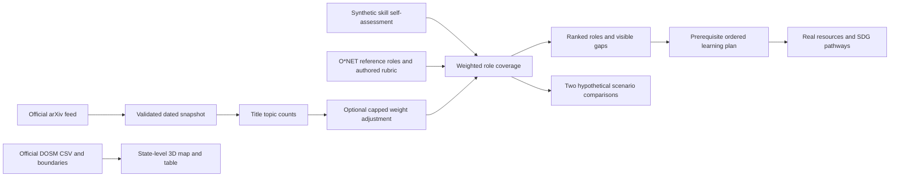

# Architecture and model card

Prepared 20 October 2026. Purpose: exploratory learning and career planning using synthetic profiles. Not suitable for hiring, screening, admission, credit, salary estimation or individual risk assessment.

## Data flow

## Components and separation

`src/components/Atlas.tsx` owns shared profile, role, evidence and navigation state. `World.tsx` renders client-only R3F worlds with demand-driven rendering and a device-pixel-ratio cap. All numerical results and selections are also in HTML panels. `EvidenceControls.tsx` exposes research adjustments and individual skill-to-SDG pathways.

`src/lib/catalogue.ts` contains authored skills, six referenced occupations, course/resource links, sample people, curated trend summaries and SDG mappings. `engine.ts` contains pure matching, pathway, scenario and export functions. `signals.ts` contains keyword topic classification and classical TF-IDF text retrieval. `public/data/` contains versioned source snapshots. Fetching from upstream is a maintenance step, not a request made with visitor profile data.

The app is a Next.js static export. No database, server-side inference, runtime API keys or uploaded CVs are required. Each visitor has an independent browser-local synthetic sample. Local storage is convenience persistence, not secure storage. Fonts may load from Google Fonts; external learning links take the visitor to their publishers. No profile text is sent with those requests.

## Matching method

For role r and required skill s, let level p be 0–5, authored target t be 1–5 and authored weight w be positive.

`coverage = round(100 × Σ[w × min(p/t, 1)] / Σ[w])`

Missing skills receive no credit. Surplus proficiency does not offset another gap. Show each term's contribution. Gap priority is `(target − level) × effective weight`; deterministic role IDs resolve ranking ties. This is a transparent design rubric, not a trained prediction model. Name and location do not enter it. That exclusion is a design property, not evidence of comprehensive fairness.

When the user enables research signals, explicit topic terms in valid unique arXiv titles generate `topicShare = matchingTitles / totalTitles`. Effective weight is `baseWeight × (1 + 0.25 × topicShare)`. The 25% cap is chosen by the authors. It is not estimated from employment outcomes. Both baseline and adjusted scores remain inspectable. A zero shift is valid when relative skill coverage is unaffected. New titles may change weights or scores without necessarily changing rank order.

TF-IDF uses six authored occupation descriptions. Term frequency is `1 + log(count)`; inverse document frequency is `log((1 + N)/(1 + documentFrequency)) + 1`; cosine similarity ranks vocabulary overlap. This is classical content retrieval, not a language model, semantic understanding, or an employability score. English vocabulary, synonyms, small corpus size and authored text limit it. Keyword extraction only proposes a mention; the user must accept and self-assess it.

## Learning plans

Start with the weighted gap order. Recursively insert each resource's prerequisites when the learner's foundation level is below 2, deduplicate, then schedule by cumulative estimated hours divided by weekly availability. All current resources have zero content fees, so budget is not yet a differentiating optimization objective. Device, connectivity, software, exams and optional certificate costs are excluded. Marking a step complete never raises a skill automatically.

## Scenarios

Progress is clamped `(year − 2026)/9`. Supported transition uses terminal adoption 0.35 and support 0.8; accelerated adoption uses 0.8 and support 0.3. Each role's exposure and augmentation coefficients are authored in the catalogue.

`pressure = round(100 × exposure × adoption)`

`capacity = round(100 × augmentation × adoption × support × (0.5 + 0.5 × coverage/100))`

The ±15 pressure-point band is an illustrative sensitivity range, not a confidence interval. No scenario probabilities, jobs lost/created, wages, or productivity growth are estimated. The scenarios are deliberately incomplete; regulation, investment, task redesign and access can differ.

## Geography and display semantics

Map polygons retain official DOSM coordinates and holes, displayed in a local planar transform: x = `(longitude − 109) × 1.05`; z derives from `(latitude − 4) × 1.05`. This is a visual coordinate transform, not an area-preserving projection or terrain model. Extrusion is `0.06 + 0.15 × unemploymentRate`. Every state/FT has a table alternative; small territories may be hard to click. Other 3D scenes are conceptual: they have no geographic accuracy claim.

## Updating responsibly

1. Fetch with the two refresh scripts; review source timestamp, observation period, raw hash and rejected records.
2. Read new research before treating it as a curated claim. A new title does not establish causality, hiring demand or Malaysian applicability.
3. Review resource availability and any access/cost change. Retain author-estimated time labels.
4. Review changes to the rubric and SDG rationale with a Malaysian career adviser and learners. Record rationale in Git.
5. Run tests and build; check the source/dates visible in the app, then deploy. A static snapshot is unchanged until rebuilt.

## Evaluation still needed

No real-person pilot, hiring outcome validation, calibrated trend forecast, multilingual evaluation or formal accessibility audit was performed. First evaluate task comprehension, explanation accuracy, resource usefulness and keyboard/mobile usability with consenting participants outside the synthetic-only competition demo. Do not treat our functional tests as scientific validation. The hardest risk is turning research signals into defensible skill-demand estimates; a future version needs longitudinal Malaysian occupational evidence and an independently reviewed evaluation design before making demand claims.

## Local resume path

File or pasted text → PDF.js / Mammoth / text reader → word-boundary skill mentions → evidence review → accepted minimum level 1 → existing deterministic role coverage and learning planner. Raw resume text remains in component memory, not profile storage. See RESUME_AND_DATA.md.
